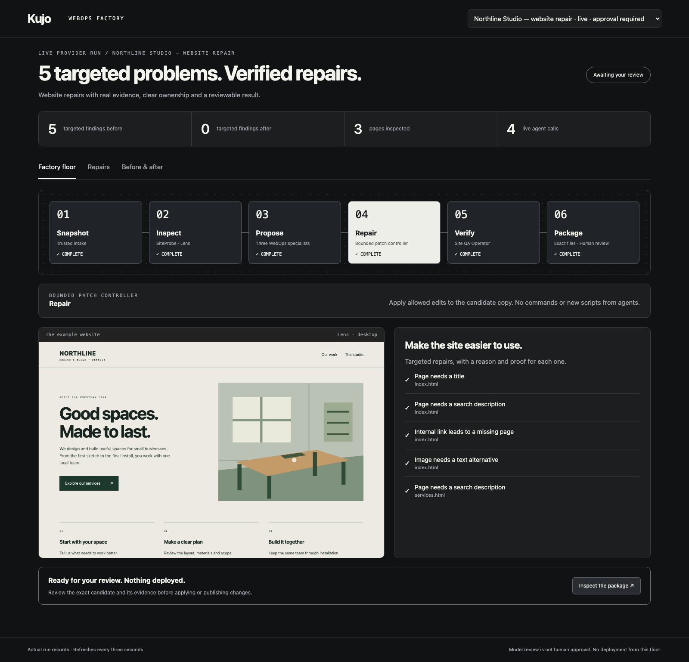

# Kujo WebOps Factory

[](package.json)
[](LICENSE)
[](https://github.com/kujolang/kujo)
[](https://github.com/kujolang/webops-factory/actions/workflows/verify.yml)

Give your website a repair team. Get scoped fixes, before-and-after evidence and a candidate you can review before anything goes live.

https://github.com/user-attachments/assets/002165df-7109-4f4d-ae17-329cae34c3fd

[Download for your phone](https://raw.githubusercontent.com/kujolang/webops-factory/main/docs/media/webops-factory-demo-mobile.mp4?v=closing-v2) · [Download 1080p](https://raw.githubusercontent.com/kujolang/webops-factory/main/docs/media/webops-factory-demo.mp4?v=closing-v2)

The demo shows the recorded live run, with ElevenLabs narration and the Kujo bumper. [Source and verification](docs/media/manifest.json).

WebOps Factory copies a static website, inspects it with SiteProbe and Lens, asks specialist agents for repairs, applies allowed edits to the copy, and checks the result again. An independent model reviewer examines the exact patch. The factory stops at human review; it does not edit the original site or deploy anything.

The visual floor shows the handoffs, repair values, reasons, browser screenshots and verification reports. Every displayed status comes from a retained run record.



## Start here

Requirements: macOS or Linux, Git, Python 3.10+, Node 26.12.1 or later 26.x, and a Codex account for live workers. No API key is required when using Codex account authentication. Provider access and usage remain subject to your account.

```bash
git clone https://github.com/kujolang/webops-factory.git
cd webops-factory
npm ci
npm run setup
npm run login
npm run doctor
npm run factory -- run examples/studio.json --live
npm start
```

Open `http://127.0.0.1:4383`. Setup installs pinned Kujo sources, the runtime and Chromium. Linux hosts may also need `npx playwright install-deps chromium`; that command installs system packages and may require administrator access. Native Windows is not supported; use WSL.

To inspect the included recorded live run before making model calls, run `npm run demo` followed by `npm start`. This imports the checked-in evidence; it does not execute a new mission. The example repaired five targeted problems across three pages in 43.443 seconds with four provider calls. See [the verification record](docs/VERIFICATION.md).

Already signed in to Codex locally? `npm run login -- --reuse-existing` copies only authentication into this factory's private, ignored provider directory. It does not import personal tools, hooks or configuration.

Use `--fixture` instead of `--live` for an explicitly labeled rehearsal with fixed proposal values. Fixture mode still runs the real crawl and browser checks, but makes no model calls. Live runs use the agents; fixture output is never presented as live agent work.

## What this release repairs

| Finding | Specialist | Allowed change |
| --- | --- | --- |
| Missing or empty page title | Metadata Auditor | Plain title text |
| Missing or empty search description | Metadata Auditor | Description content |
| Image without an `alt` attribute | Accessibility Auditor | Plain alternative text |
| Broken internal file link | Link Health Auditor | Existing local destination |

The controller accepts values for known findings. Agents cannot supply commands, executable files, arbitrary HTML, external link targets or new repair operations. A failed check or requested revision leaves the run blocked with its evidence; it does not produce an approval package.

SiteProbe can report additional problems outside this table. Those reports remain visible. Zero supported findings does not mean perfect SEO, full accessibility conformance or a security certification. Lens checks the homepage at desktop and mobile sizes; the static audit examines every imported HTML page. Fragment-only links, external link health, rankings and analytics are outside this release.

## Bring your own site

Point a mission at a static export directory, not a framework project or server application. The directory may contain HTML, CSS, SVG, common images, text and XML. Scripts, inline event handlers, frames, symlinks and active HTML embeds are rejected. Hidden files and `node_modules` are not imported. Intake is capped at 120 files and 8 MB; worker context is capped at 150 KB.

```json
{
  "title": "Repair the studio website",
  "site": "./site-export",
  "objective": "Fix supported problems while preserving the design and factual claims. Do not publish."
}
```

Save this beside `site-export` and pass its path to `npm run factory -- run PATH --live`. The site path is resolved relative to the mission. An agent can write this contract from your request using [the setup guide](docs/AGENT-SETUP.md), without changing the controller.

## Inspect the result

Each run lives under `.runtime/runs/<id>/`:

- `before/` preserves imported bytes; `candidate/` holds the repaired copy.
- `before-findings.json` and `after-findings.json` show supported checks.
- `proposals/` retains specialist and independent-review responses.
- `patches/repairs.diff` shows the exact changes.
- `evidence/` contains the actual SiteProbe and Lens artifacts.
- `package.json` binds the review candidate and evidence to file hashes.

```bash
npm run factory -- verify RUN_ID
npm run verify
```

Review the patch and candidate before moving changes into your own release process. The floor has no deploy button, and the runner has no apply-to-source command. If a run stops, inspect its error and retained evidence, clarify the mission or repair the input, and start a new run. Automatic retries and resume are not implemented.

## Built from Kujo

This standalone factory reuses the canonical WebOps specialist contracts, SiteProbe and Lens. Its bounded adapter follows the finding-to-fix workflow's evidence and permission boundaries. It does not invoke that workflow's production-mutation step or claim that the canonical workflow already implements these repairs. Source revisions are pinned in [sources.lock.json](sources.lock.json).

[Software Factory](https://github.com/kujolang/software-factory), [VideoOps Factory](https://github.com/kujolang/videoops-factory) and [Publishing House Factory](https://github.com/kujolang/publishing-house-factory) remain separate repositories. Their local run evidence and review patterns informed this factory; there is no dependency on a personal checkout or random branch.

Read [architecture](docs/ARCHITECTURE.md), [security boundaries](SECURITY.md) and [verification](docs/VERIFICATION.md).
